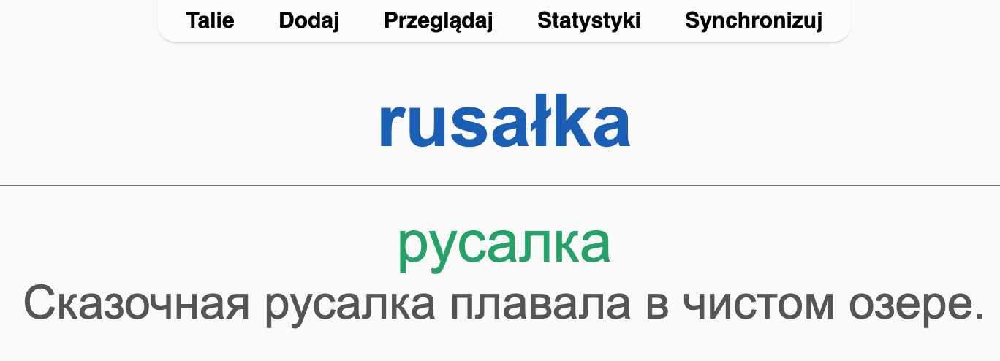
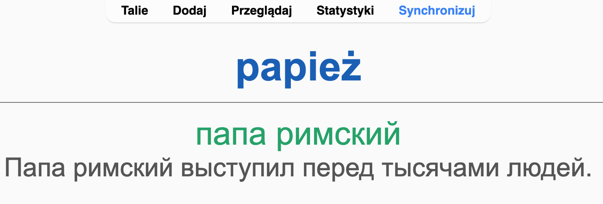

# Anki Flashcard Generator

This project allows you to generate [Anki](https://apps.ankiweb.net/) flashcards decks from a list of words.

Provide a list of words and a target target language, and the tool will produce a ready-to-import `.apkg` deck 
with translations and example sentences. The tool uses the Google Gemini API to create translations 
and generate natural example sentences for each word. 

## Usage

```python
from deck_gen.deck import Deck

deck = Deck(deck_id=1234567890, name="Level1", word_list=["rusałka", "papież"])
deck.generateFlashcards()
deck.saveDeckToFile("Level1.apkg")
```

The deck is saved in `data/decks/`. Import it into Anki with File → Import.
The detailed instruction on how to use files included in project can be found in
[`examples/deck_generation.ipynb`](examples/deck_generation.ipynb) file.

<table>
  <tr>
    <td></td>
    <td></td>
  </tr>
</table>

## Project structure

```
src/deck_gen/   # Translator, FlashCard and Deck classes
examples/       # usage examples
tests/          # tests
data/           # generated decks (not committed)
```

## Planned features

- [ ] Input from a photo of a handwritten word list (OCR)
- [ ] Audio pronunciation
- [ ] Images on cards
